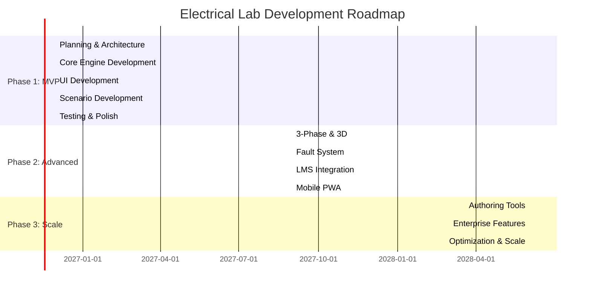
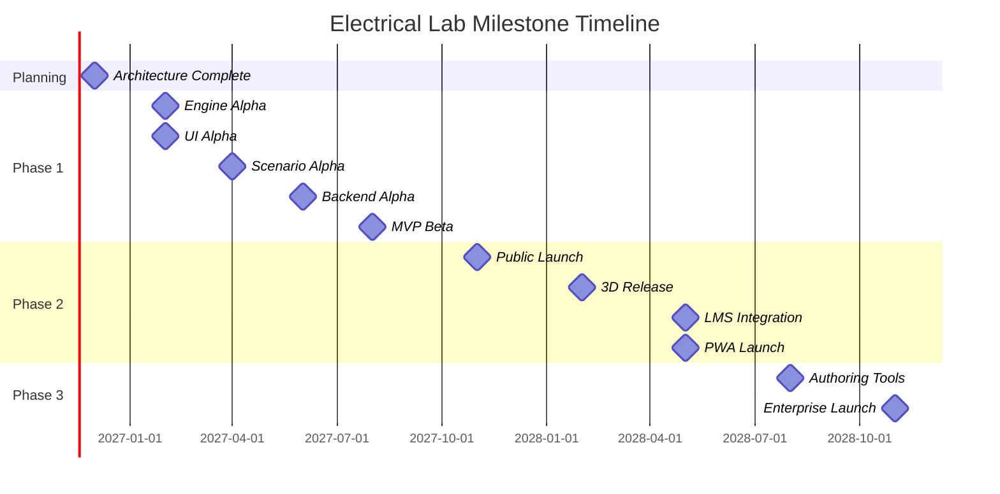

# Electrical Lab Simulation Platform - Development Roadmap

**Version:** 1.0
**Date:** November 3, 2026
**Project Duration:** 24 months
**Status:** Planning Phase

---

## Table of Contents

1. [Executive Summary](#1-executive-summary)
2. [Development Phases Overview](#2-development-phases-overview)
3. [Phase 1: MVP Foundation (Months 1-9)](#3-phase-1-mvp-foundation-months-1-9)
4. [Phase 2: Advanced Features (Months 10-18)](#4-phase-2-advanced-features-months-10-18)
5. [Phase 3: Scale & Enterprise (Months 19-24)](#5-phase-3-scale--enterprise-months-19-24)
6. [Milestone Timeline](#6-milestone-timeline)
7. [Resource Requirements](#7-resource-requirements)
8. [Risk Management](#8-risk-management)
9. [Quality Assurance Strategy](#9-quality-assurance-strategy)
10. [Go-to-Market Plan](#10-go-to-market-plan)

---

## 1. Executive Summary

This roadmap outlines a 24-month development plan for the Electrical Lab Simulation Platform, divided into three distinct phases:

- **Phase 1 (Months 1-9)**: MVP with core circuit simulation, basic scenarios, and web delivery
- **Phase 2 (Months 10-18)**: Advanced features including 3D visualization, fault injection, and LMS integration
- **Phase 3 (Months 19-24)**: Enterprise features, authoring tools, and scale optimization

The roadmap prioritizes delivering value early with a focused MVP, then iteratively adding sophistication based on user feedback and market demand.

---

## 2. Development Phases Overview



### Phase Comparison

| Aspect | Phase 1 (MVP) | Phase 2 (Advanced) | Phase 3 (Scale) |
|--------|--------------|-------------------|-----------------|
| Circuits | DC + Single-phase AC | 3-phase AC | All AC types |
| Visualization | 2D/2.5D | 3D Panel | Full 3D Environment |
| Scenarios | 6 basic | 20+ | 50+ |
| Fault System | Basic | Advanced hidden faults | Custom fault editor |
| LMS Integration | None | SCORM/xAPI | Full LTI + Custom |
| Mobile | Responsive | PWA | Native apps optional |
| Authoring | None | Templates | Full editor |
| Target | Individual learners | Schools/Institutions | Enterprise |

---

## 3. Phase 1: MVP Foundation (Months 1-9)

### 3.1 Objectives

**Primary Goals:**
- Build a functional circuit simulation engine
- Create a web-based UI with schematic and panel views
- Deliver 6 core electrical wiring scenarios
- Implement basic user authentication and progress tracking
- Validate technical approach with target users

**Success Criteria:**
- 6 scenarios working end-to-end
- < 3s page load time
- 90% task completion rate for basic scenarios
- 50 beta users with positive feedback
- Zero critical security vulnerabilities

### 3.2 Month-by-Month Breakdown

#### Month 1: Planning & Architecture

**Week 1-2: Technical Planning**
- Finalize technology stack selection
- Set up development environment
- Create project structure
- Configure CI/CD pipeline (GitHub Actions)
- Set up code quality tools (ESLint, Prettier)

**Week 3-4: Architecture Design**
- Finalize database schema
- Design API endpoints
- Create component library structure
- Define simulation engine interfaces
- Document architecture decisions

**Deliverables:**
- ✅ Technical Architecture document
- ✅ Database schema (Prisma)
- ✅ API specification
- ✅ Component library definitions
- ✅ CI/CD pipeline configured

#### Month 2-3: Core Engine Development

**Month 2: Circuit Simulation Engine**
- Implement nodal analysis solver
- Create basic component models (resistor, source, switch)
- Build circuit graph parser
- Implement DC circuit solving
- Add real-time simulation loop
- Create validation engine (short circuit detection)

**Month 3: Engine Expansion**
- Add AC circuit support (single-phase)
- Implement capacitor and inductor models
- Add current visualization
- Create measurement tool interfaces
- Optimize solver performance
- Unit tests for engine

**Deliverables:**
- ✅ Circuit simulation engine (DC + AC)
- ✅ 10+ component models
- ✅ Solver with < 100ms response time
- ✅ Unit test coverage > 80%
- ✅ Performance benchmarks

#### Month 2-3: UI Development (Parallel)

**Month 2: Core UI Framework**
- Set up React application with Vite
- Implement routing
- Create layout components
- Build authentication UI (login, register)
- Implement state management (Zustand)
- Create basic component library

**Month 3: Circuit Views**
- Implement schematic view (SVG-based)
- Create 2D panel view with drag-and-drop
- Build component palette
- Implement wire routing with snapping
- Add zoom/pan functionality
- Create measurement tool UI

**Deliverables:**
- ✅ React application scaffold
- ✅ Authentication flow
- ✅ Schematic view component
- ✅ 2D panel view component
- ✅ Wire routing system
- ✅ Component palette

#### Month 4-5: Scenario Development

**Month 4: Core Scenarios**
- Scenario 1: Simple DC circuit (battery + resistor + LED)
- Scenario 2: Light with single-pole switch
- Scenario 3: Two-way switching (stair light)
- Scenario 4: Outlet with RCD/GFCI
- Create scenario data structures
- Implement scenario loader
- Build scenario runner UI

**Month 5: Advanced Basic Scenarios**
- Scenario 5: DOL motor starter (basic)
- Scenario 6: Fault-finding basics (open circuit)
- Implement guidance system (step highlighting)
- Add validation feedback
- Create progress tracking
- Build results/feedback UI

**Deliverables:**
- ✅ 6 complete scenarios
- ✅ Scenario data format
- ✅ Guidance system
- ✅ Validation feedback
- ✅ Progress tracking
- ✅ Results display

#### Month 6-7: Backend Development

**Month 6: API & Database**
- Set up Node.js/Express backend
- Implement Prisma ORM
- Create PostgreSQL database
- Build authentication API (JWT)
- Implement user management
- Create scenario API endpoints

**Month 7: Progress & Analytics**
- Implement progress tracking API
- Add progress saving
- Create basic analytics endpoints
- Implement file upload (for custom scenarios later)
- Add rate limiting
- Create admin endpoints

**Deliverables:**
- ✅ REST API with authentication
- ✅ PostgreSQL database
- ✅ User management
- ✅ Scenario endpoints
- ✅ Progress tracking
- ✅ Basic analytics

#### Month 8: Integration & Testing

**Integration Tasks:**
- Connect frontend to backend API
- Implement offline mode (IndexedDB)
- Add service worker for PWA
- Sync local progress with server
- Test end-to-end flows
- Performance optimization

**Testing:**
- Unit tests (frontend + backend)
- Integration tests
- E2E tests (Playwright)
- Performance testing
- Security audit
- Accessibility audit (WCAG 2.1)

**Deliverables:**
- ✅ Full stack integration
- ✅ PWA with offline support
- ✅ Test suite > 70% coverage
- ✅ Performance benchmarks met
- ✅ Security audit passed
- ✅ WCAG AA compliance

#### Month 9: Beta Launch & Polish

**Beta Preparation:**
- Recruit 50 beta users
- Create onboarding documentation
- Set up feedback collection
- Configure error tracking (Sentry)
- Set up analytics (Google Analytics)
- Prepare support process

**Launch & Iteration:**
- Deploy to staging environment
- Run beta for 4 weeks
- Collect and analyze feedback
- Fix critical bugs
- Make UX improvements
- Update documentation

**Deliverables:**
- ✅ Beta deployment
- ✅ 50 beta users active
- ✅ Feedback collected
- ✅ Critical bugs fixed
- ✅ UX improvements
- ✅ Documentation updated

### 3.3 Phase 1 Tech Stack

**Frontend:**
- React 18 + TypeScript
- Vite (build tool)
- Zustand (state management)
- Tailwind CSS (styling)
- HTML5 Canvas + SVG (graphics)
- Vitest + React Testing Library (testing)

**Backend:**
- Node.js 20 + TypeScript
- Express.js (framework)
- Prisma (ORM)
- PostgreSQL (database)
- JWT (authentication)
- Redis (caching)

**Infrastructure:**
- GitHub Actions (CI/CD)
- AWS (cloud provider)
- CloudFront (CDN)
- S3 (object storage)

### 3.4 Phase 1 Budget Estimate

| Category | Cost (USD) | Notes |
|----------|-----------|-------|
| Development Team (6 people × 9 months) | $180,000 | 2 frontend, 2 backend, 1 QA, 1 SME |
| Cloud Infrastructure | $5,000 | AWS, staging environment |
| Tools & Services | $3,000 | Sentry, analytics, domain |
| SME Consulting | $10,000 | Electrical engineering validation |
| Testing & QA | $7,000 | Beta user incentives, security audit |
| **Total Phase 1** | **$205,000** | |

---

## 4. Phase 2: Advanced Features (Months 10-18)

### 4.1 Objectives

**Primary Goals:**
- Add 3-phase circuit simulation
- Implement 3D panel visualization
- Build fault injection system
- Add LMS integration (SCORM/xAPI)
- Create mobile PWA with offline mode
- Expand to 20+ scenarios

**Success Criteria:**
- 3-phase circuits working correctly
- 3D visualization rendering at 30fps+
- 10+ fault scenarios available
- SCORM package export working
- PWA installable on iOS/Android
- 200+ active users

### 4.2 Month-by-Month Breakdown

#### Month 10-12: 3-Phase & 3D Visualization

**Month 10: 3-Phase Circuit Engine**
- Extend simulation engine for 3-phase
- Implement three-phase source models
- Add phase sequence support
- Create 3-phase motor model
- Implement balanced/unbalanced load analysis
- Add power calculations (real, reactive, apparent)

**Month 11: Three.js Integration**
- Set up Three.js environment
- Create 3D scene setup
- Implement camera controls
- Add lighting system
- Create basic 3D panel model
- Implement component 3D meshes

**Month 12: 3D Panel Visualization**
- Render components in 3D
- Implement 3D wire routing
- Add terminal snapping in 3D
- Create 3D measurement tools
- Add 3D navigation (orbit, zoom)
- Optimize for performance

**Deliverables:**
- ✅ 3-phase circuit simulation
- ✅ Three.js integration
- ✅ 3D panel view
- ✅ 3D wire routing
- ✅ 3D measurement tools
- ✅ Performance optimization

#### Month 13-14: Fault System

**Month 13: Fault Injection Engine**
- Design fault data structure
- Implement fault injection system
- Create fault types (open, short, stuck, failed)
- Add fault masking (hide from user)
- Implement fault detection logic
- Create fault reporting

**Month 14: Fault Scenarios**
- Create 10 fault scenarios
- Implement guided fault-finding
- Add hint system
- Create diagnostic tools
- Build fault-finding workflow
- Add fault difficulty levels

**Deliverables:**
- ✅ Fault injection engine
- ✅ 10 fault scenarios
- ✅ Guided fault-finding
- ✅ Hint system
- ✅ Diagnostic tools
- ✅ Difficulty levels

#### Month 15-16: LMS Integration

**Month 15: SCORM Integration**
- Implement SCORM 1.2 API adapter
- Create SCORM packaging system
- Implement CMI data model
- Add completion tracking
- Create score reporting
- Test with sample LMS (Moodle)

**Month 16: xAPI & Analytics**
- Implement xAPI statement generator
- Add LRS integration
- Create analytics dashboard
- Implement learning record storage
- Add performance metrics
- Create instructor reporting

**Deliverables:**
- ✅ SCORM 1.2 integration
- ✅ SCORM packaging
- ✅ xAPI integration
- ✅ Analytics dashboard
- ✅ Instructor reports
- ✅ LMS compatibility tested

#### Month 17-18: Mobile PWA & Expansion

**Month 17: PWA Enhancement**
- Enhance service worker caching
- Add offline scenario storage
- Implement background sync
- Optimize for mobile performance
- Add touch gesture support
- Test on iOS/Android devices

**Month 18: Scenario Expansion**
- Create 14 additional scenarios (total 20+)
- Add industrial control scenarios
- Implement PLC I/O wiring
- Add VFD scenarios
- Create sensor loop scenarios
- Build adaptive difficulty system

**Deliverables:**
- ✅ Enhanced PWA
- ✅ Full offline support
- ✅ Mobile optimized
- ✅ 20+ scenarios
- ✅ Industrial scenarios
- ✅ Adaptive difficulty

### 4.3 Phase 2 Tech Stack Additions

**Frontend Additions:**
- Three.js (3D graphics)
- react-three-fiber (React + Three.js)
- @react-three/drei (Three.js helpers)
- Workbox (PWA)
- IndexedDB (offline storage)

**Backend Additions:**
- Bull (job queue)
- Additional Redis instances
- Analytics database (TimescaleDB optional)

**LMS Integration:**
- SCORM API adapter
- xAPI client library
- LRS integration

### 4.4 Phase 2 Budget Estimate

| Category | Cost (USD) | Notes |
|----------|-----------|-------|
| Development Team (8 people × 9 months) | $288,000 | Add 2 devs, 1 UX designer |
| 3D Assets & Models | $15,000 | Component 3D models |
| LMS Testing & Certification | $10,000 | SCORM certification |
| Cloud Infrastructure | $12,000 | Production environment |
| Marketing & User Acquisition | $20,000 | Initial marketing push |
| **Total Phase 2** | **$345,000** | |

---

## 5. Phase 3: Scale & Enterprise (Months 19-24)

### 5.1 Objectives

**Primary Goals:**
- Build scenario authoring tools
- Add enterprise features (SSO, white-label)
- Implement VR/WebXR support
- Create multi-language support
- Optimize for scale (10,000+ concurrent users)
- Launch enterprise sales

**Success Criteria:**
- Authoring tools functional for instructors
- 5 enterprise customers signed
- VR mode working on headsets
- 3 languages supported
- Scale testing passed (10K concurrent)
- $500K ARR achieved

### 5.2 Month-by-Month Breakdown

#### Month 19-21: Authoring Tools

**Month 19: Authoring UI**
- Design authoring interface
- Create component palette editor
- Build schematic editor
- Implement panel layout editor
- Add property editors
- Create preview mode

**Month 20: Scenario Builder**
- Implement scenario structure editor
- Add objective builder
- Create fault editor
- Build validation rule editor
- Add template system
- Implement save/export

**Month 21: Community Features**
- Create scenario sharing system
- Add community gallery
- Implement rating system
- Build comment system
- Add scenario search
- Create moderation tools

**Deliverables:**
- ✅ Authoring UI
- ✅ Scenario builder
- ✅ Fault editor
- ✅ Template system
- ✅ Community features
- ✅ Moderation tools

#### Month 22-23: Enterprise Features

**Month 22: Enterprise Integration**
- Implement SAML SSO
- Add LDAP integration
- Create white-label options
- Build multi-tenant architecture
- Add API keys for LMS
- Implement audit logging

**Month 23: VR/WebXR Support**
- Set up WebXR environment
- Create VR panel view
- Implement VR controls
- Add VR measurement tools
- Optimize for VR performance
- Test on Quest, Vision Pro

**Deliverables:**
- ✅ SAML SSO
- ✅ White-label options
- ✅ Multi-tenant architecture
- ✅ VR/WebXR mode
- ✅ VR controls
- ✅ Performance optimized

#### Month 24: Scale & Launch

**Scale Optimization:**
- Database sharding strategy
- Implement caching layers
- Add CDN for global distribution
- Optimize database queries
- Implement read replicas
- Load testing (10K concurrent)

**Enterprise Launch:**
- Create enterprise onboarding
- Build customer portal
- Implement support ticketing
- Create training materials
- Launch enterprise sales
- Hire sales team

**Deliverables:**
- ✅ Scale optimizations
- ✅ Load testing passed
- ✅ Enterprise portal
- ✅ Support system
- ✅ Sales team hired
- ✅ 5 enterprise customers

### 5.3 Phase 3 Tech Stack Additions

**Enterprise:**
- SAML2 library (SAML passport)
- Multi-tenant architecture
- API key management
- Audit logging system

**VR:**
- WebXR API
- A-Frame or React XR
- VR optimization tools

**Scale:**
- Database sharding
- Redis Cluster
- Multi-region deployment
 Advanced CDN configuration

### 5.4 Phase 3 Budget Estimate

| Category | Cost (USD) | Notes |
|----------|-----------|-------|
| Development Team (10 people × 6 months) | $300,000 | Add content author, support engineer |
| VR Development | $25,000 | VR optimization, testing |
| Enterprise Infrastructure | $20,000 | Multi-tenant setup |
| Sales & Marketing | $50,000 | Enterprise sales team |
| Legal & Compliance | $15,000 | Enterprise contracts, GDPR |
| **Total Phase 3** | **$410,000** | |

---

## 6. Milestone Timeline

### 6.1 Key Milestones

| Milestone | Date | Description | Success Criteria |
|-----------|------|-------------|------------------|
| M1: Architecture Complete | Month 1 End | Tech stack finalized, architecture documented | Architecture approved by stakeholders |
| M2: Engine Alpha | Month 3 End | Circuit engine with DC/AC support | 10+ components, solver < 100ms |
| M3: UI Alpha | Month 3 End | Basic UI with schematic and panel views | Wire routing working, validation feedback |
| M4: Scenario Alpha | Month 5 End | 6 core scenarios functional | All scenarios pass SME review |
| M5: Backend Alpha | Month 7 End | API and database functional | Auth, progress tracking working |
| M6: MVP Beta | Month 9 End | Full MVP deployed to beta users | 50 beta users, 90% positive feedback |
| M7: Public Launch | Month 12 End | MVP publicly available | 200+ active users, uptime > 99% |
| M8: 3D Release | Month 15 End | 3D visualization live | 30fps+ on target devices |
| M9: LMS Integration | Month 18 End | SCORM/xAPI integration complete | Tested with 3 LMS platforms |
| M10: PWA Launch | Month 18 End | Mobile PWA in app stores | 10K+ mobile installs |
| M11: Authoring Tools | Month 21 End | Scenario editor available | 50+ community scenarios |
| M12: Enterprise Launch | Month 24 End | Enterprise features live | 5 enterprise customers, $500K ARR |

### 6.2 Gantt Chart Summary



---

## 7. Resource Requirements

### 7.1 Team Composition

#### Phase 1 (MVP)
| Role | FTE | Responsibilities |
|------|-----|-----------------|
| Technical Lead | 1 | Architecture, code review, mentorship |
| Frontend Developer | 2 | React UI, 2D graphics, state management |
| Backend Developer | 2 | API, database, authentication |
| QA Engineer | 1 | Testing, automation, quality assurance |
| SME (Electrical) | 1 | Scenario validation, content review |
| **Total** | **7** | |

#### Phase 2 (Advanced)
| Role | FTE | Responsibilities |
|------|-----|-----------------|
| Technical Lead | 1 | Architecture, technical decisions |
| Frontend Developer | 2 | React UI, 3D graphics (Three.js) |
| Backend Developer | 2 | API, analytics, LMS integration |
| 3D Graphics Developer | 1 | Three.js, 3D models, optimization |
| QA Engineer | 1 | Testing, automation, LMS testing |
| UX Designer | 1 | UX research, design, usability testing |
| SME (Electrical) | 1 | Advanced scenarios, fault validation |
| **Total** | **9** | |

#### Phase 3 (Scale)
| Role | FTE | Responsibilities |
|------|-----|-----------------|
| Technical Lead | 1 | Architecture, scale planning |
| Frontend Developer | 2 | React UI, VR/WebXR, authoring tools |
| Backend Developer | 2 | API, enterprise features, scale |
| DevOps Engineer | 1 | Infrastructure, deployment, monitoring |
| Content Author | 1 | Scenario creation, documentation |
| Support Engineer | 1 | Customer support, onboarding |
| Sales Engineer | 1 | Enterprise sales, demos |
| SME (Electrical) | 0.5 | Review, consultation |
| **Total** | **9.5** | |

### 7.2 Infrastructure Requirements

#### Phase 1 (Development & Beta)
- **Development Environment**: Local development machines
- **Staging**: AWS t3.medium instances (2 servers)
- **Database**: AWS RDS db.t3.micro
- **Storage**: AWS S3 (10 GB)
- **CDN**: CloudFront (basic tier)
- **Estimated Monthly Cost**: $500

#### Phase 2 (Production)
- **Production**: AWS t3.large instances (3 servers, auto-scaling)
- **Database**: AWS RDS db.t3.medium (with read replica)
- **Cache**: AWS ElastiCache Redis (cache.t3.micro)
- **Storage**: AWS S3 (100 GB)
- **CDN**: CloudFront (standard tier)
- **Monitoring**: Prometheus + Grafana
- **Estimated Monthly Cost**: $1,500

#### Phase 3 (Scale)
- **Production**: Kubernetes cluster (multi-zone)
- **Database**: AWS RDS db.r5.large (multi-AZ, read replicas)
- **Cache**: AWS ElastiCache Redis (cache.m4.large, cluster)
- **Storage**: AWS S3 (500 GB)
- **CDN**: CloudFront (premium tier, global)
- **Monitoring**: Full observability stack
- **Estimated Monthly Cost**: $5,000+

### 7.3 Tools & Services

**Development Tools:**
- GitHub (code hosting, CI/CD)
- VS Code (IDE)
- Figma (design)
- Jira/Linear (project management)

**Testing Tools:**
- Vitest (unit testing)
- Playwright (E2E testing)
- BrowserStack (cross-browser testing)
- OWASP ZAP (security testing)

**Monitoring & Analytics:**
- Sentry (error tracking)
- Google Analytics (user analytics)
- Prometheus + Grafana (metrics)
- ELK Stack (logging)

**Communication:**
- Slack (team communication)
- Zoom (video meetings)
- Notion (documentation)

---

## 8. Risk Management

### 8.1 Technical Risks

| Risk | Probability | Impact | Mitigation |
|------|-------------|--------|------------|
| Circuit simulation accuracy issues | Medium | High | SME validation, comparison with SPICE, continuous testing |
| 3D performance on low-end devices | High | Medium | Quality settings, 2D fallback, performance profiling |
| Browser compatibility issues | Medium | Medium | Cross-browser testing, polyfills, progressive enhancement |
| Database scaling issues | Low | High | Start with proper schema, implement caching early, plan sharding |
| Security vulnerabilities | Low | Critical | Regular audits, pen testing, secure coding practices |

### 8.2 Market Risks

| Risk | Probability | Impact | Mitigation |
|------|-------------|--------|------------|
| Slow user adoption | Medium | High | Free tier, partner with schools, aggressive marketing |
| Competition from established players | High | Medium | Focus on unique features (safety, authoring), price competitively |
| Institutional sales cycle too long | High | Medium | Start with individual users, build case studies, hire sales team |
| Technology shifts (e.g., new standards) | Low | Medium | Stay updated with industry, modular architecture for easy updates |

### 8.3 Resource Risks

| Risk | Probability | Impact | Mitigation |
|------|-------------|--------|------------|
| Key developer departure | Medium | High | Good documentation, knowledge sharing, competitive compensation |
| SME availability issues | Medium | Medium | Contract multiple SMEs, build internal expertise over time |
| Budget overruns | Medium | Medium | Phased approach, regular budget reviews, scope management |
| Timeline delays | High | Medium | Buffer in schedule, prioritize MVP features, agile approach |

### 8.4 Risk Response Plan

**High Priority Risks:**
1. **Circuit simulation accuracy** - Daily SME review during Phase 1
2. **User adoption** - Free tier + marketing budget from Day 1
3. **Key developer departure** - Documentation + knowledge sharing from start

**Monitoring:**
- Weekly risk review in stand-ups
- Monthly risk assessment with stakeholders
- Quarterly risk report to leadership

---

## 9. Quality Assurance Strategy

### 9.1 Testing Pyramid

```
        /\
       /E2E\          Playwright (10%)
      /------\
     /  Integration  \   Integration tests (30%)
    /----------------\
   /     Unit Tests    \  Vitest (60%)
  /----------------------\
```

### 9.2 Testing Strategy

**Unit Tests (Target: 80% coverage):**
- Circuit simulation engine
- Component models
- API endpoints
- Utility functions
- State management

**Integration Tests:**
- Frontend + backend integration
- Database operations
- Authentication flows
- Progress saving/syncing
- Offline mode

**E2E Tests:**
- Complete scenario workflows
- User registration to completion
- LMS integration flows
- Cross-browser testing
- Mobile testing

**Performance Tests:**
- Circuit simulation speed
- API response times
- Page load times
- 3D rendering frame rate
- Concurrent user load

**Security Tests:**
- OWASP Top 10 vulnerabilities
- Penetration testing
- Authentication security
- Data encryption validation
- API security

**Accessibility Tests:**
- WCAG 2.1 AA compliance
- Screen reader testing
- Keyboard navigation
- Color contrast
- Alt text validation

### 9.3 Quality Gates

**Before Each Release:**
- All tests passing
- Code coverage > 80%
- No critical security issues
- Performance benchmarks met
- Accessibility audit passed
- SME validation for scenarios

**Beta Release (Phase 1):**
- 50 beta users
- 90% task completion rate
- Average rating > 4/5
- Zero critical bugs

**Public Launch (Phase 2):**
- 200+ active users
- Uptime > 99%
- Load test passed (1K concurrent)
- LMS compatibility verified

**Enterprise Launch (Phase 3):**
- 5 pilot customers
- Enterprise features validated
- Scale test passed (10K concurrent)
- Security audit passed

### 9.4 Continuous Quality

**CI/CD Pipeline:**
1. Code push triggers CI
2. Run unit tests
3. Run linting
4. Build application
5. Run integration tests
6. Deploy to staging
7. Run E2E tests
8. Performance tests
9. Security scan
10. Manual QA approval
11. Deploy to production

**Code Review:**
- All PRs require at least 1 approval
- Automated checks must pass
- SME review for scenario changes
- Security review for auth changes

---

## 10. Go-to-Market Plan

### 10.1 Target Audiences

**Primary (Phase 1-2):**
- Individual apprentices and students
- TVET schools and trade programs
- Hobbyists and DIY enthusiasts
- Electricians preparing for certification

**Secondary (Phase 2-3):**
- Corporate training departments
- Electrical unions
- Technical colleges
- Industrial companies

**Enterprise (Phase 3):**
- Large manufacturing companies
- Utility companies
- Government training programs
- Multi-national corporations

### 10.2 Marketing Channels

**Digital Marketing:**
- SEO (content marketing, blog)
- Social media (YouTube, LinkedIn, Reddit)
- Paid advertising (Google Ads, Facebook)
- Email marketing
- Content marketing (tutorials, case studies)

**Partnerships:**
- Electrical equipment manufacturers
- Certification bodies (NCCER, etc.)
- LMS providers (Canvas, Blackboard)
- Educational publishers
- Trade associations

**Community Building:**
- Discord/Slack community
- User forums
- Scenario sharing platform
- User-generated content
- Webinars and workshops

**Direct Sales (Enterprise):**
- Cold outreach
- Industry conferences
- Case studies
- Free pilots
- Reference customers

### 10.3 Pricing Strategy

**Free Tier:**
- 5 basic scenarios
- Basic feedback
- No progress tracking
- Ad-supported or session limits

**Pro Tier (Individual):**
- $9.99/month or $99/year
- Full scenario library
- Progress tracking
- Offline mode
- No ads
- Certificate of completion

**Institutional Tier:**
- $500/year for 50 seats
- All Pro features
- Instructor dashboard
- LMS integration
- Custom scenarios
- Priority support

**Enterprise Tier:**
- Custom pricing (starting at $10K/year)
- All Institutional features
- SSO integration
- White-label options
- Custom development
- Dedicated support
- SLA guarantees

### 10.4 Launch Timeline

**Phase 1 Launch (Month 9):**
- Beta launch with 50 users
- Collect feedback
- Iterate quickly
- Build case studies

**Phase 2 Launch (Month 12):**
- Public launch
- App store submission (PWA)
- Content marketing push
- Partner outreach

**Phase 3 Launch (Month 24):**
- Enterprise features launch
- Sales team active
- Case studies from pilot customers
- Industry conference presence

### 10.5 Success Metrics

**User Metrics:**
- Monthly Active Users (MAU)
- User acquisition cost (CAC)
- User lifetime value (LTV)
- Churn rate
- Scenario completion rate

**Business Metrics:**
- Monthly Recurring Revenue (MRR)
- Annual Recurring Revenue (ARR)
- Customer acquisition cost (CAC)
- Customer lifetime value (LTV)
- Conversion rate (free to paid)

**Product Metrics:**
- Average session duration
- Scenario completion rate
- User satisfaction (NPS)
- Feature usage
- Bug reports

---

## Conclusion

This development roadmap provides a clear path from MVP to enterprise platform over 24 months. The phased approach allows for:

1. **Early Value Delivery**: MVP in 9 months with core functionality
2. **Iterative Improvement**: Add features based on user feedback
3. **Risk Mitigation**: Validate market before heavy investment
4. **Scalable Growth**: Build for scale from the start
5. **Market Validation**: Test pricing and features with real users

Key success factors:
- **Focus on MVP**: Don't over-engineer early phases
- **User Feedback**: Continuous testing and iteration
- **SME Involvement**: Ensure technical accuracy
- **Quality First**: Comprehensive testing at each phase
- **Market Awareness**: Adjust based on competition and user needs

With proper execution, this roadmap positions the platform to capture significant market share in the electrical simulation training space.

---

**Document Version:** 1.0
**Last Updated:** November 3, 2026
**Next Review:** After Phase 1 completion (Month 9)
