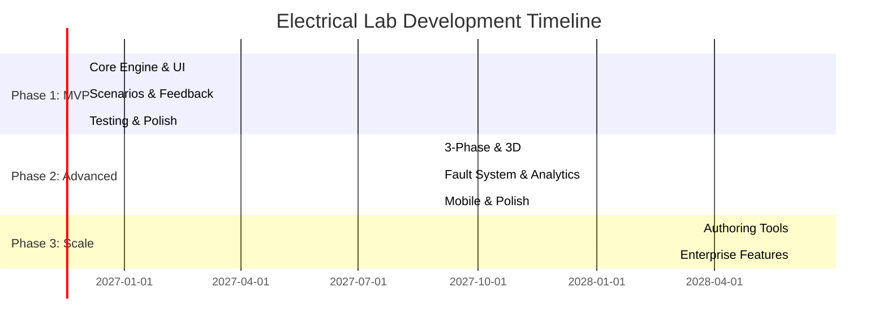

# Electrical Lab Simulation Platform - Research Report

**Date:** November 3, 2026
**Project:** Virtual Electrical Workshop Simulation
**Repository:** https://github.com/devstephenke-sys/Electrical-Labs.git

---

## Executive Summary

This report documents research into existing electrical simulation platforms and provides recommendations for building a virtual electrical workshop simulation platform. The platform aims to provide a browser-based, interactive learning environment for electrical apprentices, technicians, and engineers to practice wiring, testing, and troubleshooting electrical circuits in a safe, realistic virtual environment.

### Key Findings

1. **Market Opportunity**: Existing platforms like EDWartens Panel Lab, TPC Simulations, and mobile apps like Electrical Wiring Simulator demonstrate strong demand for virtual electrical training, with 1M+ users on mobile platforms.

2. **Technical Approach**: Start with a precise 2D/2.5D interactive workshop with a deterministic simulation engine. 3D environments should be introduced after core wiring, testing, and assessment workflows are proven.

3. **Learning Model**: Implement a four-rung scaffolded approach: (1) Understanding Schematics, (2) Guided Wiring, (3) Self-check & Fault-Finding, (4) Reflection & Assessment.

4. **Target Timeline**: MVP in 6-9 months, full platform in 18-24 months, with estimated costs ranging from $100K (minimal MVP) to $1M+ (enterprise-grade platform).

---

## 1. Existing Platform Analysis

### 1.1 EDWartens Panel Lab

**Strengths:**
- Browser-based 3D electrical workshop with no installation required
- Strong emphasis on safety procedures (lockout/tagout, prove dead)
- 33 progressive levels from basic to advanced
- Realistic panel wiring with terminal-to-terminal connections
- Factory Acceptance Test (FAT) methodology for assessment
- Free for basic use, subscription for certificates

**Key Features:**
- 3D panel backplate view with realistic component placement
- Virtual multimeter for voltage measurements
- Step-by-step briefs and checks
- Real-time validation of wiring
- Industrial control scenarios (DOL starters, star-delta, PLC)

**Learning Approach:**
- Three-phase workflow: Read brief → Do job → Pass test
- Emphasizes real-world job context
- Systematic fault-finding methodology

**Technical Observations:**
- Web-based, runs in browser
- 3D graphics (likely WebGL-based)
- Wire snapping to terminals
- Real-time circuit simulation

**What to Adopt:**
- Safety-first workflow (lockout → prove dead → wire → test)
- Brief-driven scenario structure
- Factory Acceptance Test concept
- Progressive difficulty levels

**What to Improve:**
- Limited to industrial control panels (no residential/household scenarios)
- No graded curriculum or adaptive learning
- Minimal gamification elements

---

### 1.2 TPC Training Simulations

**Strengths:**
- 170+ hours of troubleshooting experience
- 450 virtual troubleshooting scenarios
- Systematic troubleshooting methodology
- Adaptive learning (faults get harder as skills improve)
- Comprehensive analytics dashboard
- Industrial focus (controls, PLC, VFDs, sensors)

**Key Features:**
- Immersive 3D environments
- Virtual multimeter with voltage/resistance readings
- Reference materials (schematics, wiring diagrams, manuals)
- Guided faults and skill test faults
- Real-time feedback with scores and cost calculations
- Admin dashboard for managers

**Learning Approach:**
- Hands-on digital experiences
- Systematic root cause analysis
- Progressive difficulty
- Hints and worksheets for stuck learners

**Metrics & Analytics:**
- Accuracy scores
- Safety metrics
- Efficiency (time, steps)
- Cost calculations for simulated repairs
- Performance tracking over time

**What to Adopt:**
- Systematic troubleshooting methodology
- Metrics framework (accuracy, safety, efficiency)
- Hint system for stuck learners
- Guided vs. skill test fault modes
- Industrial scenario breadth

**What to Improve:**
- Closed system (no custom authoring)
- Enterprise pricing (not accessible to individuals)
- More focused on troubleshooting than initial wiring

---

### 1.3 PhET Circuit Construction Kit (DC)

**Strengths:**
- Free, open-source educational resource
- Intuitive drag-and-drop interface
- Real-time voltage/current visualization
- Lifelike and schematic component views
- Excellent for teaching basic circuit theory

**Key Features:**
- DC circuits with resistors, batteries, switches
- Real-time current animation (moving dots)
- Voltage and current measurements
- Short circuit detection with fire graphic
- View toggle between realistic and schematic

**Learning Approach:**
- Build → Explore → Measure → Experiment
- Sample challenge prompts for teachers
- Interactive exploration of Ohm's law, Kirchhoff's law

**Technical Observations:**
- HTML5-based (works on mobile/tablets)
- Node-based circuit simulation
- Self-consistent current calculation
- Simple, accessible UI

**What to Adopt:**
- Real-time current visualization
- Dual view (realistic + schematic)
- Simple component library for beginners
- Safety warnings (short circuit detection)

**What to Improve:**
- DC only (no AC circuits)
- No industrial components (motors, PLCs)
- No wiring workflow or safety procedures
- Limited to basic circuit theory

---

### 1.4 Falstad Circuit Simulator

**Strengths:**
- Free, browser-based circuit simulator
- Animated circuit behavior (current flow visualization)
- Real-time voltage/current graphs (oscilloscope-like)
- Extensive component library
- Can export circuits as shareable links

**Key Features:**
- Animated schematic with voltage color coding
- Moving yellow dots for current flow
- Three oscilloscope graphs at bottom
- Speed controls for simulation
- Large library of sample circuits
- JavaScript interface for programmatic control

**Technical Observations:**
- Node-based simulation
- Can handle AC, DC, digital circuits
- Real-time circuit solving
- Component parameter editing
- Can be embedded in other sites

**What to Adopt:**
- Real-time current animation
- Oscilloscope visualization
- Component parameter editing
- Shareable circuit links
- Extensive component library

**What to Improve:**
- No wiring workflow or panel view
- No safety procedures
- More physics-focused than vocational
- No guided learning paths

---

### 1.5 Electrical Wiring Simulator (Mobile App)

**Strengths:**
- Mobile-first design (800K+ downloads)
- Step-by-step guided practice
- Used in TVETs and training centers worldwide
- LMS integration for schools
- Offline capability
- Comprehensive training modules

**Key Features:**
- AC/DC series-parallel circuits
- Residential wiring
- Magnetic contactors, relays, solenoid valves
- Motors and motor control
- Real-time simulation
- Progress tracking
- Pro tier with certificates

**Learning Approach:**
- Mobile-accessible training
- Guided tutorials
- Exam/certification prep
- Save progress across sessions

**Technical Observations:**
- Native mobile apps (iOS/Android)
- Point-to-point wiring
- Snap-to-grid interface
- Node-based simulation
- Cloud circuit sharing

**What to Adopt:**
- Mobile-first responsive design
- Point-to-point wiring interface
- Training module structure
- LMS integration capabilities
- Certificate system

**What to Improve:**
- Limited mobile screen real estate for complex panels
- Simplified components (not full industrial realism)
- No 3D visualization
- No safety lockout procedures

---

## 2. Competitive Landscape Summary

| Platform | Target Audience | Pricing | Key Strength | Main Gap |
|----------|---------------|---------|--------------|----------|
| EDWartens Panel Lab | Industrial electrical trainees | Free + subscription | Realistic 3D panel wiring, safety procedures | No residential scenarios, limited curriculum |
| TPC Simulations | Industrial maintenance technicians | Enterprise subscription | Systematic troubleshooting, analytics | Closed system, high cost |
| PhET Circuit Kit | Physics students | Free | Circuit theory visualization | DC only, no industrial focus |
| Falstad Simulator | Electronics hobbyists/students | Free | Real-time circuit animation | No wiring workflow, physics-focused |
| Electrical Wiring Simulator | Apprentices, TVET students | Freemium | Mobile-first, comprehensive modules | Limited realism, no 3D |
| Interplay Learning | Enterprise training | Enterprise licensing | VR support, industry-recognized | Very expensive, closed content |

**Market Gap Identified**: A web-based platform that combines:
- EDWartens' realistic panel wiring and safety procedures
- TPC's systematic troubleshooting and analytics
- Mobile accessibility like Electrical Wiring Simulator
- Open authoring for instructors
- Accessible pricing (freemium model)

---

## 3. Technical Architecture Recommendations

### 3.1 Core Technology Stack

#### Frontend
- **Framework**: React or Vue.js for SPA
- **Graphics**: Three.js or Babylon.js for 3D panel visualization
- **2D Canvas**: HTML5 Canvas or SVG for schematics and 2D wiring
- **UI Library**: Material-UI or Tailwind CSS for responsive design
- **State Management**: Redux or Zustand for complex state
- **Build Tool**: Vite for fast development

#### Circuit Simulation Engine
**Option A: Custom JavaScript Engine (Recommended for MVP)**
- Node-based nodal analysis (similar to Falstad)
- DC and single-phase AC support
- Real-time circuit solving
- Extensible component library
- Pros: Full control, no external dependencies, can optimize for education needs
- Cons: Initial development effort

**Option B: WebAssembly Port of NGSpice**
- Compile NGSpice to WebAssembly
- Industry-standard SPICE simulation
- Pros: Mature, tested, supports complex circuits
- Cons: Overkill for basic wiring, larger bundle size

**Option C: Falstad/CircuitJS Integration**
- Fork Falstad's JavaScript simulator
- Pros: Proven, feature-rich
- Cons: Not designed for wiring workflows, GPL license concerns

**Recommendation**: Start with Option A (custom engine) for MVP, can evolve to Option B if complex AC/3-phase simulation needed.

#### Backend
- **Runtime**: Node.js with Express or Python with FastAPI
- **Database**: PostgreSQL for structured data (users, scenarios, progress)
- **File Storage**: AWS S3 or similar for circuit diagrams, 3D models
- **Authentication**: JWT tokens, support for OAuth/SSO
- **API**: REST or GraphQL

#### LMS Integration
- **SCORM**: SCORM 1.2/2004 wrapper for LMS packages
- **xAPI**: Learning Record Store integration for detailed analytics
- **LTI**: LTI 1.3 for tool provider integration

### 3.2 System Architecture

```
┌─────────────────────────────────────────────────────────────┐
│                        Browser Client                       │
│  ┌──────────────┐  ┌──────────────┐  ┌──────────────┐      │
│  │   React UI   │  │  3D Engine   │  │ Circuit Sim  │      │
│  │              │  │  (Three.js)  │  │   Engine     │      │
│  └──────────────┘  └──────────────┘  └──────────────┘      │
└─────────────────────────────────────────────────────────────┘
                              │
                              │ HTTP/HTTPS
                              │
┌─────────────────────────────────────────────────────────────┐
│                     Backend API Server                      │
│  ┌──────────────┐  ┌──────────────┐  ┌──────────────┐      │
│  │   Auth API   │  │  Scenario    │  │   Progress   │      │
│  │              │  │   Manager    │  │   Tracker    │      │
│  └──────────────┘  └──────────────┘  └──────────────┘      │
└─────────────────────────────────────────────────────────────┘
                              │
                              │
        ┌─────────────────────┼─────────────────────┐
        │                     │                     │
┌───────▼──────┐    ┌────────▼────────┐    ┌───────▼──────┐
│ PostgreSQL   │    │   Object Store  │    │  LRS / LMS   │
│   Database   │    │  (S3, Cloud)    │    │  Integration │
└──────────────┘    └─────────────────┘    └──────────────┘
```

### 3.3 Offline/Progressive Web App (PWA)

For mobile users and offline practice:
- Service Worker for caching scenarios and simulation engine
- IndexedDB for local progress storage
- Sync with backend when online
- Critical for areas with poor internet connectivity

---

## 4. Feature Prioritization

### 4.1 MVP Features (Phase 1 - 6-9 months)

**Must-Have:**
1. ✅ User authentication and basic profiles
2. ✅ Circuit simulation engine (DC + single-phase AC)
3. ✅ Schematic view with interactive diagrams
4. ✅ 2D/2.5D panel view with drag-and-drop wiring
5. ✅ Virtual multimeter (voltage, continuity)
6. ✅ Safety check system (lockout, prove dead)
7. ✅ 5-10 guided scenarios (light+switch, outlet, DOL starter)
8. ✅ Step-by-step guidance mode
9. ✅ Auto-check and feedback system
10. ✅ Progress saving and basic reporting
11. ✅ Mobile-responsive design
12. ✅ WCAG 2.1 accessibility compliance

**Scenarios for MVP:**
1. Simple DC circuit (battery + resistor + LED)
2. Light with single-pole switch
3. Two-way switching (stair light)
4. Outlet with RCD/GFCI
5. DOL motor starter (basic)
6. Fault-finding basics (open circuit)

### 4.2 Phase 2 Features (9-15 months)

**Should-Have:**
1. 3-phase circuits
2. Advanced motor controls (star-delta, reversing)
3. PLC I/O wiring
4. Fault injection system
5. 3D panel visualization
6. Adaptive difficulty (unlock system)
7. Gamification (points, badges, leaderboards)
8. Instructor dashboard
9. SCORM/xAPI export
10. Component library expansion (VFDs, sensors, relays)
11. Hints system
12. PWA with offline mode

**Additional Scenarios:**
7. Star-delta motor starter
8. Forward/reverse with interlock
9. PLC-controlled conveyor
10. Industrial sensor loop (4-20mA)
11. Advanced fault-finding (motor control, PLC)
12. Load balancing exercise

### 4.3 Phase 3 Features (15-24 months)

**Nice-to-Have:**
1. Full authoring tool for instructors
2. VR/WebXR support
3. Multi-language support
4. Official certification integration
5. Advanced analytics dashboards
6. Community circuit sharing
7. Curriculum builder
8. Integration with industry standards databases
9. Advanced 3D environments (factory floor, house)
10. Virtual reality mode

---

## 5. Pedagogical Design Framework

### 5.1 Four-Rung Learning Model

Based on EDWartens approach, adapted for broader scope:

**Rung 1: Understanding Schematics**
- Interactive schematic review
- Component identification quizzes
- Power/control path tracing
- Annotations and highlights
- Pre-wiring knowledge check

**Rung 2: Guided Wiring**
- Step-by-step terminal highlighting
- Real-time validation
- Numbered wire system
- Color-coded conductors
- Error explanations with corrections
- One-circuit-at-a-time approach

**Rung 3: Self-Check & Fault-Finding**
- Fault report reading
- Systematic isolation procedures
- Virtual multimeter usage
- Voltage and continuity tracing
- Diagnostic decision-making
- Progressive hints

**Rung 4: Reflection & Assessment**
- Factory Acceptance Test (FAT) checklist
- Pass/fail scoring
- Time and error metrics
- Safety compliance scoring
- Answer key view
- Debrief with common errors
- Post-scenario quiz

### 5.2 Feedback Mechanisms

**Immediate Feedback:**
- Real-time validation during wiring
- "Circuit incomplete" messages
- Specific error identification (e.g., "Wire 3N missing")
- Safety warnings (e.g., "Circuit not isolated")

**Cumulative Scoring:**
- Accuracy: % of correct connections
- Safety: penalty for unsafe actions
- Efficiency: time and steps vs. optimal
- Total score weighted by scenario

**Adaptive Learning:**
- Branching based on performance
- Redirect struggling learners to tutorials
- Unlock advanced scenarios upon mastery
- Personalized next recommendations

**Gamification:**
- Points per scenario completion
- Badges for achievements (e.g., "Lockout Learner", "Master Troubleshooter")
- Leaderboards (optional, can be disabled)
- Progress bars and level indicators
- Streak tracking for consistent practice

### 5.3 Safety Emphasis

**Enforced Safety Workflow:**
1. LOTO required before any wiring
2. Prove dead with multimeter before touching
3. Verify isolation
4. Tag-out documentation
5. Only then allow wiring
6. Re-verify before energizing

**Safety Metrics:**
- Track LOTO compliance
- Penalize unsafe actions
- Safety score included in assessment
- Safety reminders and hints
- NFPA 70E/IEC 60204 alignment

---

## 6. Development Roadmap

### Phase 1: MVP Foundation (Months 1-9)

**Months 1-3: Core Engine & UI**
- Set up project structure and CI/CD
- Develop circuit simulation engine (DC + basic AC)
- Build React UI framework
- Implement schematic view
- Create 2D panel view with drag-and-drop
- Basic multimeter tool
- User authentication system

**Months 4-6: Scenarios & Feedback**
- Develop 6 core scenarios
- Implement step-by-step guidance
- Build auto-check system
- Progress tracking
- Basic reporting
- Mobile responsive design

**Months 7-9: Testing & Polish**
- QA and bug fixes
- Usability testing with target users
- Accessibility audit
- Performance optimization
- Beta testing
- Documentation

**Team**: 4-6 developers (2 frontend, 2 backend, 1 QA, 1 SME)
**Estimated Cost**: $100K - $250K

### Phase 2: Advanced Features (Months 10-18)

**Months 10-12: 3-Phase & 3D**
- 3-phase circuit simulation
- Three.js 3D panel visualization
- Advanced motor control scenarios
- PLC I/O wiring

**Months 13-15: Fault System & Analytics**
- Fault injection engine
- Hidden fault scenarios
- Instructor dashboard
- SCORM/xAPI integration
- Gamification system

**Months 16-18: Mobile & Polish**
- PWA with offline mode
- Expanded component library
- Adaptive learning logic
- Additional scenarios (15+ total)
- LMS certification integration

**Team**: Add 1-2 developers, 1 UX designer
**Estimated Cost**: Additional $200K - $400K

### Phase 3: Scale & Authoring (Months 19-24+)

**Months 19-21: Authoring Tools**
- Scenario editor UI
- Fault editor
- Template system
- Preview mode
- Community sharing

**Months 22-24: Enterprise Features**
- Multi-language support
- VR/WebXR mode
- Advanced analytics
- Certification system
- Enterprise SSO
- White-label options

**Team**: Add content author, support engineer
**Estimated Cost**: Additional $300K - $500K

### Timeline Visualization



---

## 7. Testing & Validation Plan

### 7.1 Usability Testing

**Target Users:**
- Electrical apprentices (beginners)
- Technicians (intermediate)
- Instructors/trainers
- Hobbyists/students

**Methods:**
- Think-aloud protocols during scenario completion
- Task completion time measurements
- Error rate tracking
- SUS (System Usability Scale) surveys
- A/B testing for UI variations

**Success Criteria:**
- 90% task completion rate for basic scenarios
- Average completion time within 2x expert time
- SUS score > 70 (good usability)
- Zero critical accessibility violations

### 7.2 Learning Effectiveness Validation

**Pre/Post Testing:**
- Knowledge assessment before and after using platform
- Control group (traditional training) vs. experimental group (simulation)
- Measure retention at 1 week, 1 month, 3 months

**Metrics:**
- Knowledge gain percentage
- Skill transfer to real equipment
- Confidence surveys
- Time to proficiency comparison

**Expected Outcomes:**
Based on research (cited in executive summary):
- 30-50% higher knowledge retention vs. video/text
- Faster skill acquisition
- Higher confidence in real-world tasks
- Fewer safety incidents during real training

### 7.3 Technical Testing

**Performance:**
- Load testing with 1000+ concurrent users
- Circuit simulation speed ( < 100ms per update)
- 3D rendering frame rate ( > 30fps on target devices)
- PWA offline functionality

**Compatibility:**
- Browser testing (Chrome, Firefox, Safari, Edge)
- Mobile testing (iOS, Android)
- Screen reader testing (NVDA, JAWS)
- Touch device testing

**Security:**
- Penetration testing
- OWASP Top 10 compliance
- GDPR/COPPA compliance for student data
- Secure authentication implementation

### 7.4 Content Validation

**Subject Matter Expert Review:**
- Electrical engineers review all scenarios
- Validate against IEC/NFPA standards
- Check wiring procedures for correctness
- Verify component specifications

**Pilot Programs:**
- Partner with 2-3 TVET schools
- Collect structured feedback
- Iterate based on real classroom use
- Compare assessment results

---

## 8. Commercial Model Recommendations

### 8.1 Pricing Tiers

**Free Tier:**
- 5 basic scenarios (DC circuits, simple lighting)
- Limited component library
- Basic feedback
- No progress tracking across sessions
- No certificates
- Ad-supported or limited sessions per day

**Pro Tier (Individual - $9.99/month or $99/year):**
- Full scenario library (20+ scenarios)
- All components and tools
- Progress tracking and analytics
- Offline mode
- No ads
- Certificate of completion
- Priority support

**Institutional Tier (School/Company - Custom pricing):**
- All Pro features for all students
- Instructor dashboard
- Class management
- LMS integration (SCORM, LTI, xAPI)
- Custom scenario authoring
- White-label options
- Dedicated support
- Volume discounts (50+ seats)

**Enterprise Tier (Large organizations - $50K+/year):**
- All Institutional features
- Custom integrations
- API access
- On-premise deployment option
- SLA guarantees
- Custom curriculum development
- Training and onboarding

### 8.2 Revenue Projections

**Year 1 (Launch):**
- Target: 5,000 individual Pro users
- Target: 10 institutional customers (avg 100 seats)
- Revenue: ~$5,000/mo + $50,000/yr = ~$110,000/yr

**Year 2 (Growth):**
- Target: 20,000 individual Pro users
- Target: 30 institutional customers
- Revenue: ~$20,000/mo + $150,000/yr = ~$390,000/yr

**Year 3 (Scale):**
- Target: 50,000 individual Pro users
- Target: 100 institutional customers
- Revenue: ~$50,000/mo + $500,000/yr = ~$1.1M/yr

### 8.3 Marketing Strategy

**Target Channels:**
- TVET schools and trade programs
- Electrical unions and associations
- Corporate training departments
- Online communities (Reddit, YouTube tutorials)
- App stores (mobile versions)
- Educational conferences and trade shows

**Partnerships:**
- Electrical equipment manufacturers
- Certification bodies (NCCER, etc.)
- LMS providers (Canvas, Blackboard, Moodle)
- Educational publishers

---

## 9. Risk Assessment & Mitigation

### 9.1 Technical Risks

**Risk: Circuit simulation accuracy**
- Mitigation: SME validation, testing against real circuits, open-source SPICE comparison

**Risk: Performance on low-end devices**
- Mitigation: Progressive enhancement, quality settings, 2D fallback mode

**Risk: 3D rendering compatibility**
- Mitigation: WebGL feature detection, graceful degradation, polyfill libraries

### 9.2 Market Risks

**Risk: Competition from established players**
- Mitigation: Focus on unique combination (realistic panel + safety + open authoring + accessible pricing)

**Risk: Slow adoption in conservative institutions**
- Mitigation: Free pilot programs, case studies, partnerships with early adopters

**Risk: Pricing pressure from free alternatives**
- Mitigation: Emphasize unique features (safety procedures, assessment, LMS integration)

### 9.3 Content Risks

**Risk: Outdated or incorrect standards**
- Mitigation: Regular SME reviews, subscription to standards updates, community feedback

**Risk: Limited scenario library**
- Mitigation: Authoring tools, community sharing, template system

### 9.4 Legal/Compliance Risks

**Risk: Liability for training incidents**
- Mitigation: Clear disclaimers, emphasize simulation vs. real equipment, certification alignment

**Risk: Data privacy (student data)**
- Mitigation: GDPR/COPPA compliance, secure storage, minimal PII collection

---

## 10. Success Metrics

### 10.1 Product Metrics

**User Engagement:**
- Monthly active users (MAU)
- Session duration
- Scenario completion rate
- Return user rate

**Learning Outcomes:**
- Average score improvement
- Time to proficiency
- Certificate completion rate
- Post-training skill assessment scores

**Technical:**
- Uptime > 99.5%
- Page load time < 3s
- Simulation frame rate > 30fps
- Error rate < 0.1%

### 10.2 Business Metrics

**Revenue:**
- MRR (Monthly Recurring Revenue)
- CAC (Customer Acquisition Cost)
- LTV (Lifetime Value)
- Churn rate < 5%/month

**Market Penetration:**
- Number of institutional customers
- Geographic reach
- Partnership count
- Industry adoption

---

## 11. Recommendations Summary

### 11.1 Immediate Next Steps

1. **Technical Proof of Concept (4-6 weeks)**
   - Build minimal circuit simulation engine
   - Create simple 2D panel UI
   - Implement one basic scenario (light + switch)
   - Validate with SME

2. **Market Validation (ongoing)**
   - Survey target users (apprentices, instructors)
   - Interview 5-10 potential institutional customers
   - Gather feedback on pricing and features

3. **Team Assembly**
   - Hire technical lead with electrical engineering background
   - Recruit frontend developer with WebGL experience
   - Contract SME for scenario design

### 11.2 Strategic Decisions

**Start Simple:**
- Begin with 2D/2.5D panel view (not full 3D)
- Focus on DC and single-phase AC first
- Prioritize safety procedures over component breadth
- Start with web-only, add mobile PWA later

**Differentiation Strategy:**
- Emphasize safety procedures (LOTO, prove dead)
- Focus on systematic troubleshooting methodology
- Provide open authoring for instructors
- Maintain accessible pricing (freemium model)

**Phased Rollout:**
- MVP with 6 core scenarios
- Beta with partner schools
- Public launch with 10+ scenarios
- Expand based on user feedback

### 11.3 Critical Success Factors

1. **Technical Credibility**: Accurate circuit simulation is non-negotiable
2. **Safety Emphasis**: Must align with NFPA 70E/IEC standards
3. **User Experience**: Intuitive wiring interface is critical
4. **Content Quality**: Scenarios must be realistic and educationally sound
5. **Performance**: Must work smoothly on school computers and mobile devices
6. **Accessibility**: WCAG compliance for inclusive education

---

## 12. Conclusion

The market for electrical simulation training is established and growing, with clear demand from TVET schools, corporate training programs, and individual learners. Existing platforms demonstrate the viability of the concept but leave gaps in combining realistic panel wiring, systematic safety procedures, comprehensive curriculum, and accessible pricing.

By starting with a focused MVP that emphasizes:
- Accurate circuit simulation
- Safety-first workflow
- Guided, scaffolded learning
- Realistic industrial scenarios
- Accessible web-based delivery

The platform can establish a strong foundation and evolve based on user feedback and market demand. The recommended phased approach allows for iterative improvement while managing development risk and cost.

With proper execution, the platform can capture a significant share of the electrical training market while providing genuine educational value to learners and institutions worldwide.

---

## References

1. EDWartens Panel Lab - https://lab.edwartens.com/electrical-wiring-simulator
2. TPC Training Simulations - https://www.tpctraining.com/cloud-based-simulations
3. PhET Circuit Construction Kit - https://phet.colorado.edu/en/simulations/circuit-construction-kit-dc-virtual-lab
4. Falstad Circuit Simulator - https://www.falstad.com/circuit/
5. Electrical Wiring Simulator - https://play.google.com/store/apps/details?id=com.SageApprentice.ElectricalWiringSimulator
6. Interplay Learning - https://www.interplaylearning.com/
7. Tinkercad Circuits - https://www.tinkercad.com/circuits
8. NFPA 70E Standard for Electrical Safety in the Workplace
9. IEC 60364 Wiring Regulations
10. IEC 60204-1 Safety of Machinery - Electrical Equipment

---

**Report Prepared By:** Devin AI Assistant
**Date:** November 3, 2026
**Version:** 1.0
